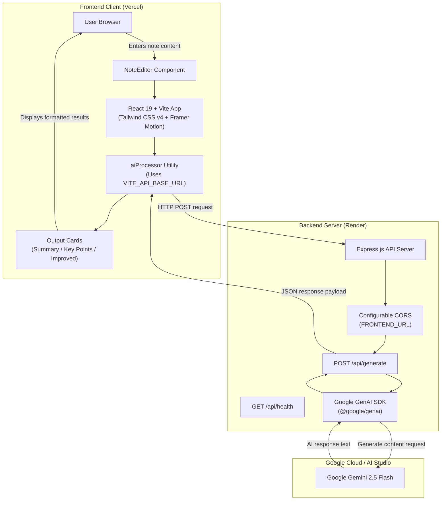
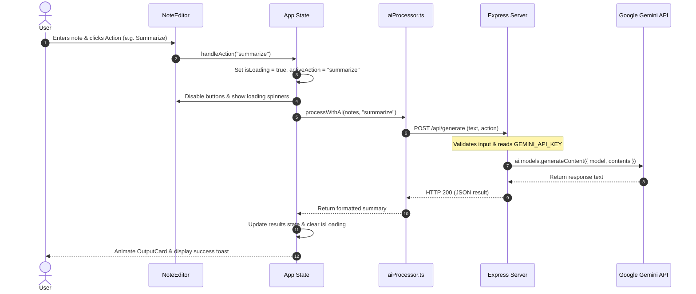
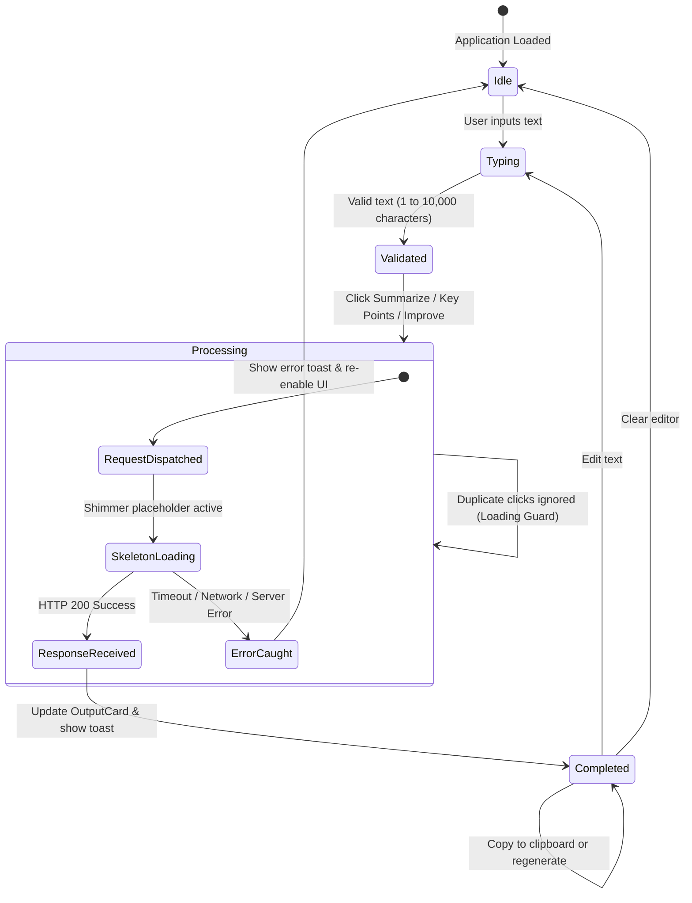
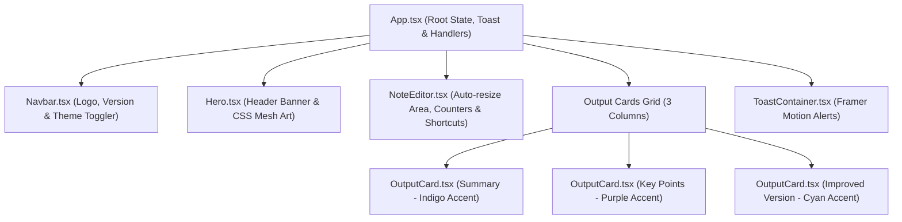

# <p align="center"> SmartNotes AI</p>

<p align="center">
  <strong>Transform raw, messy thoughts into crisp summaries, structured bullet points, and polished writing — powered by Google Gemini.</strong>
</p>

<p align="center">
  
  
  
  
  
  
  
  
</p>

<p align="center">
  <a href="https://smartnotes-esch1suwk-titan90.vercel.app/" target="_blank">
    
  </a>
  <a href="https://smartnotes-7pcn.onrender.com/api/health" target="_blank">
    
  </a>
</p>

<p align="center">
  <a href="https://smartnotes-esch1suwk-titan90.vercel.app/" target="_blank"><strong>🚀 Open Live Application: https://smartnotes-esch1suwk-titan90.vercel.app/ →</strong></a>
</p>

---

## 📋 Table of Contents
- [🔍 Overview](#-overview)
- [⚡ Key Features](#-key-features)
- [🏗️ System Architecture & Diagrams](#-system-architecture--diagrams)
  - [1. Full-Stack System Architecture](#1-full-stack-system-architecture)
  - [2. AI Generation Sequence Diagram](#2-ai-generation-sequence-diagram)
  - [3. Interactive State & UI Lifecycle](#3-interactive-state--ui-lifecycle)
  - [4. Component Hierarchy](#4-component-hierarchy)
- [📂 Project Structure](#-project-structure)
- [🛠️ Tech Stack](#️-tech-stack)
- [🚀 Quickstart & Local Setup](#-quickstart--local-setup)
- [🌐 Cloud Deployment (Vercel + Render)](#-cloud-deployment-vercel--render)
  - [Step 1: Deploy Backend to Render](#step-1-deploy-backend-to-render)
  - [Step 2: Deploy Frontend to Vercel](#step-2-deploy-frontend-to-vercel)
  - [Step 3: Connect Frontend to Backend via CORS](#step-3-connect-frontend-to-backend-via-cors)
- [🔒 Security & Secret Management](#-security--secret-management)
- [📡 API Reference](#-api-reference)
- [📄 License](#-license)

---

## 🔍 Overview

**SmartNotes AI** is a modern, high-performance note intelligence application designed to help creators, students, and professionals distill, organize, and refine notes instantly.

Built with a decoupled **React 19 + Vite frontend** and a dedicated **Express + `@google/genai` backend**, SmartNotes AI keeps your secret API credentials secure on the server while delivering instant, animated, real-time responses to the browser.

---

## ⚡ Key Features

| Feature | Description |
| :--- | :--- |
| **✨ Smart Summarization** | Condenses lengthy notes, lectures, and articles into essential, readable takeaways. |
| **📋 Key Point Extraction** | Automatically pulls out high-impact, actionable insights into formatted bullet points. |
| **✍️ Writing Improvement** | Enhances grammar, clarity, vocabulary, and tone while preserving the original message. |
| **⚡ Real Google Gemini AI** | Powered by Google's official `@google/genai` SDK using `gemini-2.5-flash`. |
| **🔒 Zero Key Exposure** | API keys are kept 100% server-side in `server/.env` — never exposed in frontend code or Git. |
| **⌨️ Keyboard Shortcuts** | Hit <kbd>Ctrl</kbd> + <kbd>Enter</kbd> (or <kbd>Cmd</kbd> + <kbd>Enter</kbd>) to instantly summarize without leaving the keyboard. |
| **🌓 Dark & Light Mode** | Smooth theme switching with custom CSS variables and persistent localStorage memory. |
| **📋 One-Click Copy & Regenerate** | Copy formatted outputs with instant visual confirmation, or regenerate specific cards. |
| **🛡️ Duplicate Submission Guards** | Prevents rapid double-clicks while AI queries are running, with active loading indicators. |

---

## 🏗️ System Architecture & Diagrams

### 1. Full-Stack System Architecture



---

### 2. AI Generation Sequence Diagram



---

### 3. Interactive State & UI Lifecycle



---

### 4. Component Hierarchy



---

## 📂 Project Structure

```text
smart-notes/
├── .env.example              # Frontend template (VITE_API_BASE_URL)
├── .gitignore                # Excludes node_modules, dist, .env, and server/.env
├── vercel.json               # SPA client routing rewrite configuration for Vercel
├── index.html                # HTML entry point (Inter font & React root)
├── package.json              # Frontend scripts & dependencies (React 19, Vite, Tailwind v4)
├── tsconfig.json             # TypeScript compiler options
├── vite.config.ts            # Vite configuration with React & Tailwind plugins
│
├── server/                   # 🚀 Dedicated Node.js & Express Backend
│   ├── .env.example          # Backend template (GEMINI_API_KEY, PORT, FRONTEND_URL)
│   ├── index.js              # Express API server (CORS, rate limiting, Gemini SDK)
│   ├── package.json          # Server dependencies (@google/genai, express, cors, dotenv)
│   └── README.md             # Detailed backend setup & API documentation
│
└── src/                      # 🎨 React Application Source
    ├── App.tsx               # Top-level orchestrator & application state
    ├── main.tsx              # React DOM 19 client mounting
    ├── index.css             # Tailwind v4 import, CSS design tokens & illustrations
    ├── vite-env.d.ts         # Vite client TypeScript definitions
    ├── components/
    │   ├── Navbar.tsx        # Header & light/dark mode switch
    │   ├── Hero.tsx          # Decorative header banner
    │   ├── NoteEditor.tsx    # Textarea, word/char counters, keyboard shortcuts
    │   ├── OutputCard.tsx    # Spring animated cards with copy & regenerate
    │   └── ToastContainer.tsx# Floating alerts (success, error, info)
    ├── hooks/
    │   ├── useTheme.ts       # Theme manager with localStorage persistence
    │   └── useToast.ts       # Notification dispatch hook
    └── utils/
        ├── aiProcessor.ts    # Frontend HTTP client & keypoint parser
        └── clipboard.ts      # Safe clipboard copy API helper & word counter
```

---

## 🛠️ Tech Stack

### Frontend
* **Core:** React 19 (`react` ^19.2.7, `react-dom` ^19.2.7)
* **Build Tool:** Vite 8 (`vite` ^8.1.1)
* **Language:** TypeScript 6 (`typescript` ~6.0.2)
* **Styles:** Tailwind CSS v4 (`@tailwindcss/vite`, `tailwindcss` ^4.3.3)
* **Animation:** Framer Motion (`framer-motion` ^12.42.2)
* **Icons:** Lucide React (`lucide-react` ^1.25.0)

### Backend
* **Runtime:** Node.js (ES Modules `"type": "module"`)
* **Framework:** Express.js (`express` ^4.21.2)
* **AI Provider:** Google Gemini API (`@google/genai` ^2.28.0)
* **Utilities:** CORS (`cors` ^2.8.5), Dotenv (`dotenv` ^16.4.7)

---

## 🚀 Quickstart & Local Setup

### 1. Clone the repository
```bash
git clone https://github.com/tanush326k/Smart-Notes.git
cd Smart-Notes
```

### 2. Configure the Backend
Navigate to the server directory:
```bash
cd server
npm install
```

Create your local `.env` file:
```bash
# Windows (PowerShell)
Copy-Item .env.example .env

# macOS / Linux
cp .env.example .env
```

Open `server/.env` and insert your [Google AI Studio API Key](https://aistudio.google.com/):
```env
GEMINI_API_KEY=your_actual_gemini_api_key_here
PORT=3001
FRONTEND_URL=http://localhost:5173
GEMINI_MODEL=gemini-2.5-flash
```

Start the backend:
```bash
npm run dev
```
*(The server runs on `http://localhost:3001`)*

### 3. Start the Frontend
In a **new terminal tab**, navigate back to the project root:
```bash
cd ..
npm install
npm run dev
```
Open **`http://localhost:5173`** in your browser.

---

## 🌐 Cloud Deployment (Vercel + Render)

* **Live Frontend:** [https://smartnotes-esch1suwk-titan90.vercel.app/](https://smartnotes-esch1suwk-titan90.vercel.app/)
* **Live Backend API:** [https://smartnotes-7pcn.onrender.com](https://smartnotes-7pcn.onrender.com) (Health: [`/api/health`](https://smartnotes-7pcn.onrender.com/api/health))

### Step 1: Deploy Backend to Render

1. Go to [Render Dashboard](https://dashboard.render.com/) and click **New +** $\rightarrow$ **Web Service**.
2. Connect your GitHub repository: `https://github.com/tanush326k/Smart-Notes`.
3. Configure the service settings:
   * **Name:** `smart-notes-backend`
   * **Root Directory:** `server` ⚠️ *(Crucial)*
   * **Runtime:** `Node`
   * **Build Command:** `npm install`
   * **Start Command:** `npm start`
   * **Instance Type:** `Free`
4. Add Environment Variables:
   * `GEMINI_API_KEY` = `your_gemini_api_key`
   * `GEMINI_MODEL` = `gemini-2.5-flash`
   * `FRONTEND_URL` = `https://smartnotes-esch1suwk-titan90.vercel.app`
5. Click **Deploy Web Service**.
6. Your live Render URL will be generated (e.g. `https://smartnotes-7pcn.onrender.com`).

---

### Step 2: Deploy Frontend to Vercel

1. Go to [Vercel Dashboard](https://vercel.com/) and click **Add New...** $\rightarrow$ **Project**.
2. Import your GitHub repository: `https://github.com/tanush326k/Smart-Notes`.
3. Configure the build settings:
   * **Framework Preset:** `Vite`
   * **Root Directory:** `./` (Leave default)
   * **Build Command:** `npm run build`
   * **Output Directory:** `dist`
4. In **Environment Variables**, add:
   * `VITE_API_BASE_URL` = `https://smartnotes-7pcn.onrender.com` *(Your Render URL without trailing slash)*
5. Click **Deploy**.
6. Your live Vercel URL is live: [https://smartnotes-esch1suwk-titan90.vercel.app/](https://smartnotes-esch1suwk-titan90.vercel.app/).

---

### Step 3: Connect Frontend to Backend via CORS

Return to your **Render Web Service** dashboard $\rightarrow$ **Environment Variables**:
* Set `FRONTEND_URL` to `https://smart-notes.vercel.app` (your live Vercel domain).
* Click **Save Changes**. Render will automatically update without downtime!

---

## 🔒 Security & Secret Management

* **No Frontend Leakage:** The Gemini API Key is stored and consumed strictly by `server/index.js` on Node.js. It is never exposed in client bundles, browser network headers, or Vite environment variables.
* **Strict Git Exclusions:** `.gitignore` excludes `.env`, `server/.env`, and all `.env.*` variants. Only `.env.example` templates with placeholders exist in the repository.
* **CORS Restrictions:** In production, requests to the backend are restricted to your designated Vercel frontend origin.

---

## 📡 API Reference

### Health Check
```http
GET /api/health
```
**Response (200 OK):**
```json
{
  "status": "ok",
  "uptime": 42,
  "timestamp": "2026-10-11T10:00:00.000Z"
}
```

### AI Generation
```http
POST /api/generate
Content-Type: application/json
```
**Body:**
```json
{
  "text": "Your notes or content to analyze...",
  "action": "summarize"
}
```
* **Supported actions:** `"summarize"`, `"keyPoints"`, `"improveWriting"`
* **Response (200 OK):**
```json
{
  "result": "Generated content returned by Google Gemini..."
}
```

---

## 📄 License

This project is licensed under the [MIT License](LICENSE).
